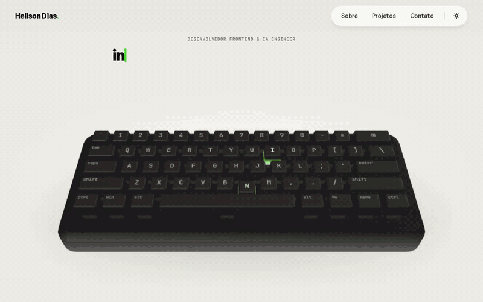

# Helison Dias — Portfólio

🔗 **Ao vivo:** [helisondias.vercel.app](https://helisondias.vercel.app)

[](https://github.com/helisondias07/portfolio/actions/workflows/ci.yml)

<!-- TODO(Helison): gravar um print do hero (desktop e mobile) e salvar em docs/demo.gif, depois descomentar a linha abaixo -->
<!--  -->

Portfólio pessoal (redesign 2026) em **Next.js 16 / React 19 / TypeScript**.

## Seções
- **Hero** — headline digitada, teclado 3D (three.js) + terminal no desktop; conversa estilo chat em tablet/celular.
  - three.js é carregado sob demanda (dynamic import) só em telas ≥ 1024px, após o `load` + idle; a área é reservada no CSS (sem layout shift).
  - Em GPUs por software (SwiftShader/llvmpipe) o render é limitado (~25 fps, pixel ratio menor).
  - Após a intro, o teclado 3D reage ao teclado físico (sem `preventDefault`).
- **Sobre** — bio com revelação por scroll e contadores (10+ lojas Wake, 2 anos e 6 meses).
- **Projetos** — carrossel coverflow com 12 projetos reais (`data/projects.ts`) e **Case em destaque** que acompanha o projeto ativo com crossfade.
- **Contato** — WhatsApp, LinkedIn, GitHub, Baixar CV, newsletter e selo Lighthouse (só aparece com notas ≥ 90; valores em `data/lighthouse.ts`).
- Tema claro/escuro com revelação circular (View Transitions API + fallback), salvo em `localStorage`, padrão do sistema.

## Estrutura
```
app/            layout (script anti-flash de tema, preload de fontes), page, globals.css, api/
components/     Nav, ThemeToggle, Hero, About, Counters, Projects, Footer, Newsletter, PerfBadge, VisitBeacon
lib/engines/    hero.js (teclado/terminal/chat + three.js lazy), projects.js (carrossel + case)
lib/server/     kv.ts (Upstash, opcional), resend.ts (Resend, opcional)
data/           projects.ts, lighthouse.ts
public/         fonts/ (woff2 subset latin), thumbnails/ (AVIF + WebP), cv/
```

## Desenvolvimento
```bash
npm install
cp .env.example .env.local   # opcional
npm run dev
npm run lint && npm run build
```

## APIs
| Rota | O que faz | Env |
|---|---|---|
| `POST /api/newsletter` | valida e-mail, honeypot, rate limit 5/h por IP, salva no Segment e envia confirmação | `RESEND_API_KEY`, `RESEND_FROM`, `RESEND_AUDIENCE_ID`, `KV_*` |
| `POST /api/visit` | ignora bots, 1 aviso por IP/dia, teto diário, e-mail com cidade/país (headers geo da Vercel) | `RESEND_API_KEY`, `NOTIFY_EMAIL`, `KV_*` |

Sem variáveis de ambiente tudo continua funcionando: a newsletter responde `503 not_configured` (o formulário mostra uma mensagem amigável) e o beacon de visita vira no-op.

## Deploy (Vercel)
1. Marketplace → **Upstash Redis** → conectar ao projeto (injeta `KV_REST_API_URL`/`KV_REST_API_TOKEN`).
2. Resend: verificar um domínio, criar um Segment; definir `RESEND_API_KEY`, `RESEND_FROM`, `RESEND_AUDIENCE_ID`, `NOTIFY_EMAIL`, `IP_SALT`.
3. Depois do deploy, medir o Lighthouse na URL de produção e atualizar `data/lighthouse.ts`.

## Qualidade

- `npm run lint` e `npm run build` rodam no CI (GitHub Actions) a cada push/PR

## Licença

MIT © Helison Dias
